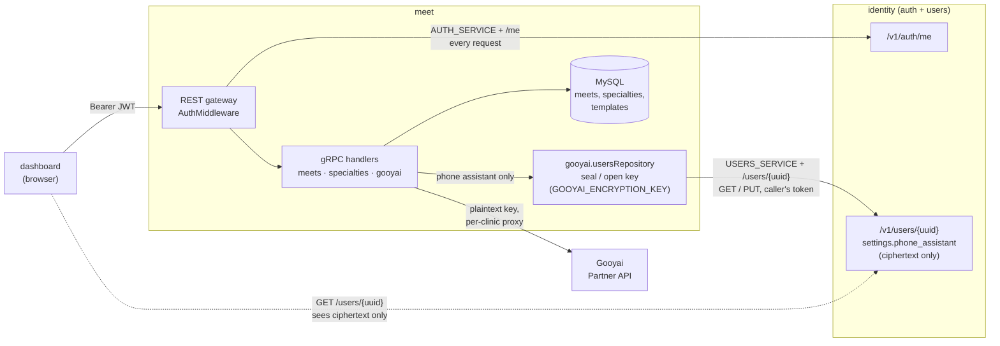
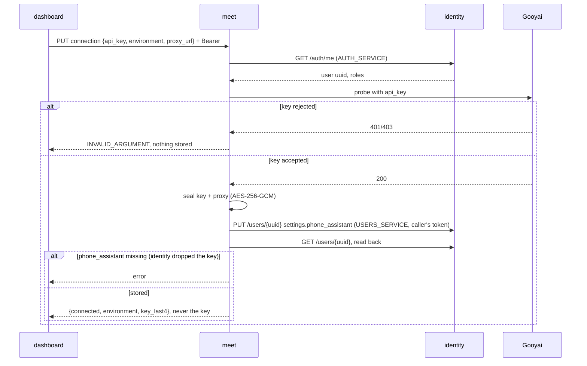
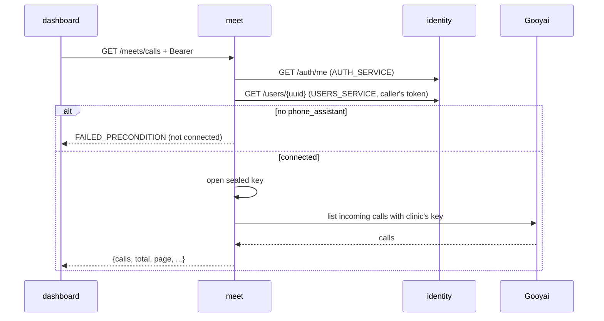

# Architecture

Go gRPC microservice managing **meets** (appointments/meetings for psychologists & doctors). Single binary runs **two servers concurrently** (see `cmd/api/app.go` → `App.Serve`):

- **gRPC** server on `GRPC_PORT` (default 50052; `.env.example` uses 50051) — `cmd/api/grpc.go`
- **REST** gateway (grpc-gateway) on `APP_PORT` (default 8080) under `REST_PREFIX` (default `/api/v1`) — `cmd/api/rest.go`

The REST server is a thin reverse-proxy: it dials the local gRPC server and translates HTTP↔gRPC. Every REST route maps to a gRPC method via `google.api.http` annotations in the proto. There is no separate REST handler logic.

## Request flow

```
HTTP → REST gateway (rest.go) → gRPC (grpc.go) → internal/meets/handler.go
     → internal/meets/service.go (business rules) → internal/meets/repository.go (MySQL)
```

Layering is strict and interface-driven (`Handler` → `Service` → `Repository`), each with its own `_test.go`. Repository uses `database/sql` with `go-sqlmock` in tests.

## Boot sequence (`main.go` → `setup()`)

1. `configs.Init()` loads `.env` (godotenv) + env vars.
2. Zap logger initialized to `storage/logs/app-<date>.log`.
3. MySQL pool via `github.com/salahfarzin/utils/db` (shared internal lib).
4. `App{Configs, Logger, DB, AllowedOrigins}` → `Serve()` (graceful shutdown on SIGINT/SIGTERM).

## Auth (delegated)

This service does **not** issue or validate tokens itself. `rest.go`'s `AuthMiddleware` takes the incoming `Bearer` token and calls `AUTH_SERVICE + "/me"`; on 200 it injects the `User` (uuid, roles) into context. The gateway forwards `x-user`, `x-user-uuid`, `x-user-roles` headers as gRPC metadata.

- `APP_ENV=test` swaps in `TestAuthMiddleware` (auth disabled) for E2E.
- `retrieveOrganizerUuid` (handler.go): organizer defaults to the authenticated user's uuid; only the `super-admin` role may set an arbitrary `organizer_uuid` (admin/impersonation).
- Roles arrive from `/me` as slugs (`super-admin`, `admin`); `internal/meets/roles.go` must match them exactly.

## External services (identity)

Meet calls one external service, **identity**, which handles both auth and users. It is configured through two variables that point at the same service:



| var | example | used for |
|-----|---------|----------|
| `AUTH_SERVICE` | `https://id.example.com/v1/auth` | `GET /me` per request, to resolve the caller (required) |
| `USERS_SERVICE` | `https://id.example.com/v1` | `GET`/`PUT /users/{uuid}` to read/write the clinic's `settings.phone_assistant`; `GET /me` under `AUTH_DISABLED` (optional; unset disables the phone assistant) |

`USERS_SERVICE` is needed only because the phone assistant (Gooyai) API key is stored **in the clinic's user settings on identity, not in meet's database** (`internal/gooyai/repository.go`, `usersRepository`). Why it was built this way:

- No table or migration in meet; the key lives with the clinic's other settings.
- Identity's own rules decide who may touch whose settings, because meet calls it with the **caller's own bearer token**. Meet doesn't need its own ownership check.
- Settings reach the browser, so meet stores only AES-256-GCM ciphertext (`GOOYAI_ENCRYPTION_KEY`); the plaintext key exists only inside meet.

Saving a connection (`PUT /meets/phone-assistant/connection`):



Using it (`GET /meets/calls`, `/providers`):



A Gooyai webhook (Phase 2) would enter at `M` with no Bearer token, so meet couldn't make the `GET /users/{uuid}` call. That is the webhook cost listed below.

Costs:

- **Webhooks (Phase 2):** a Gooyai webhook carries no user token, so meet can't read the key without a service credential on identity.
- **Runtime coupling:** connecting or listing calls fails if identity is down. Saving also fails if identity drops the `phone_assistant` settings key, and it drops that key silently.
- **Two variables for one service:** they exist because the two were once separate (auth vs psychometrist's users API).

Options if this becomes a problem: derive `USERS_SERVICE` from `AUTH_SERVICE` (strip `/auth`), or move the key into a meet table keyed by organizer. The second option removes the dependency and unblocks webhooks, but needs a migration and its own ownership checks.

## Health & docs

Health endpoints bypass auth: `<prefix>/health`, `/live`, `/ready` (`internal/health`). Swagger UI + OpenAPI/Postman served from embedded files at `<prefix>/docs/`, `/openapi.yaml`, `/postman_collection.json`.
